<div align="center">

<picture>
  <source media="(prefers-color-scheme: dark)" srcset="assets/hero-dark.svg">
  <source media="(prefers-color-scheme: light)" srcset="assets/hero-light.svg">
  
</picture>

<br>

### I build personal AI: the kind that stays with you all day, remembers, and by default asks before it sends, deletes or pays.

[fuber.ai](https://fuber.ai) &nbsp;·&nbsp; [Fuber AI](https://fuber.ai/products/fuber-ai/) &nbsp;·&nbsp; [FUBERNEURO](https://fuber.ai/research/) &nbsp;·&nbsp; [ZILKO](https://zilko.co) &nbsp;·&nbsp; [BIDORA](https://bidora.fuber.ai) &nbsp;·&nbsp; [Chat](https://chat.fuber.ai) &nbsp;·&nbsp; [FuberWords](https://word.fuber.ai)

<br>


</div>

<br>

**🔢 By the numbers**

<table>
<tr>
<td align="center" width="33%"><a href="#ch7"></a><br>demo versions of v2 in three days</td>
<td align="center" width="33%"><a href="#ch7"></a><br>commits in eight days, 16 to 23 Nov</td>
<td align="center" width="33%"><a href="#ch2"></a><br>to first sound, local voice</td>
</tr>
<tr>
<td align="center"><a href="#ch1"></a><br>IPC channels, v1 to v2</td>
<td align="center"><a href="#ch5"></a><br>products with their own page</td>
<td align="center"><a href="#ch1"></a><br>generations of one assistant</td>
</tr>
</table>

<picture>
  <source media="(prefers-color-scheme: dark)" srcset="assets/building-dark.svg">
  <source media="(prefers-color-scheme: light)" srcset="assets/building-light.svg">
  
</picture>

**🚧 On the bench right now**

- 🤖 **Fuber AI v3** · `3.0.0-alpha.1`. Two apps became one, and the interface is being redrawn from the first pixel.
- 🧠 **FUBERNEURO** · Phase 0, research and design: the AI behind a neural interface.
- 📦 **The source is open** · [Fuber AI v1](https://github.com/fberkehan/fuber-ai-v1) (Apache-2.0) and [Fuber AI v2](https://github.com/fberkehan/fuber-ai-v2) (FSL-1.1-ALv2) are public.

<br>

## 📚 Contents

<table>
<tr>
<td width="50%" valign="top">📖&nbsp;<a href="#prologue"><b>Prologue</b></a><br><sub>Who is writing, and why AI</sub></td>
<td width="50%" valign="top">🤖&nbsp;<a href="#ch1"><b>1 · Fuber AI</b></a><br><sub>The Jarvis I always wanted</sub></td>
</tr>
<tr>
<td width="50%" valign="top">⚙️&nbsp;<a href="#ch2"><b>2 · Under the hood</b></a><br><sub>Voice pipeline, three brains, memory</sub></td>
<td width="50%" valign="top">🥽&nbsp;<a href="#ch3"><b>3 · Beyond the screen</b></a><br><sub>Holographic HUD, Quest 3, Galaxy Watch</sub></td>
</tr>
<tr>
<td width="50%" valign="top">🧠&nbsp;<a href="#ch4"><b>4 · FUBERNEURO</b></a><br><sub>Reading intent from the brain</sub></td>
<td width="50%" valign="top">🧰&nbsp;<a href="#ch5"><b>5 · The shelf</b></a><br><sub>ZILKO, BIDORA, Fuber AI on mobile and web, FuberWords</sub></td>
</tr>
<tr>
<td width="50%" valign="top">🧪&nbsp;<a href="#ch6"><b>6 · The lab</b></a><br><sub>Ideas, with their real status</sub></td>
<td width="50%" valign="top">🏗️&nbsp;<a href="#ch7"><b>7 · How we build</b></a><br><sub>Working with Claude, and the rules we keep</sub></td>
</tr>
<tr>
<td width="50%" valign="top">🗓️&nbsp;<a href="#ch8"><b>8 · Timeline</b></a><br><sub>Dated milestones only</sub></td>
<td width="50%" valign="top">🧱&nbsp;<a href="#ch9"><b>9 · Stack</b></a><br><sub>What it is all made of</sub></td>
</tr>
<tr>
<td colspan="2" valign="top">✉️&nbsp;<a href="#epilogue"><b>Epilogue</b></a><br><sub>What is next, and how to reach us</sub></td>
</tr>
</table>

Sections marked with ▸ open. The short version is on the page, and the depth is one click away.

<br>

<a name="prologue"></a>

<picture>
  <source media="(prefers-color-scheme: dark)" srcset="assets/chapter-00-dark.svg">
  <source media="(prefers-color-scheme: light)" srcset="assets/chapter-00-light.svg">
  
</picture>

## 📖 Prologue

I'm Furkan. I build AI products, and I build them with AI. Everything on this page belongs to one family of projects, and the family is called **FUBER**.

What I wanted was easy to say and hard to make: an assistant that stays next to me all day, that I talk to out loud, that remembers, that speaks up on its own when something is due, and that can build itself a new ability when I ask for one. Not a chat window. So I built it, used it, found everything wrong with it, and rebuilt it on a new core. This page is the notebook of that work, plus everything else on the bench: a research program on neural interfaces, and four products, each with a page of its own.

Two rules hold the rest together. **By default, the assistant asks before it sends, deletes, pays or runs a command.** And **nothing goes on a page of ours without evidence**, which is why you will not find user counts, customer logos or awards here either.

<br>

<a name="ch1"></a>

<picture>
  <source media="(prefers-color-scheme: dark)" srcset="assets/chapter-01-dark.svg">
  <source media="(prefers-color-scheme: light)" srcset="assets/chapter-01-light.svg">
  
</picture>

## 🤖 Chapter 1 · Fuber AI: the Jarvis I always wanted


**Fuber AI is a personal assistant for the Windows desktop.** It starts with the computer and lives in the tray. You wake it with a phrase and talk. The main window is a command centre you can open, not a door you have to walk through.

By default it answers to "Jarvis". The name and the wake phrase are settings, not branding: Jarvis is only the default persona name, and this project is not affiliated with any trademark owner.

The plan is simple: I use it myself for six months. If it earns its place on my desk, it becomes a product.

One note on the link at the top: the product page on fuber.ai still describes the first generation (v1, in private beta). This page is ahead of it.

### 🧬 Three generations

<picture>
  <source media="(prefers-color-scheme: dark)" srcset="assets/generations-dark.svg">
  <source media="(prefers-color-scheme: light)" srcset="assets/generations-light.svg">
  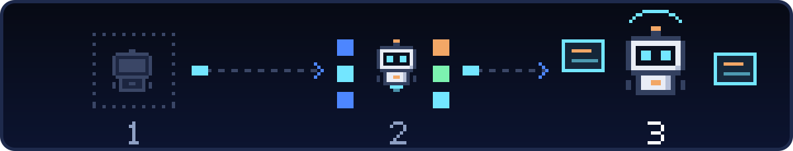
</picture>

**🥚 v1 · the first try.** Memory and chats stayed on your computer, and the wake phrase was "Hey Fuber". Archived at `0.18.2`. Its open-source edition, [fuber-ai-v1](https://github.com/fberkehan/fuber-ai-v1) (Apache-2.0), is fully local-first and runs on a model you bring yourself.

**🐣 v2 · the rewrite.** A small core, with everything else a module. Voice first. "Hey Jarvis" by default. Sixteen demo versions in three days. Its source-available edition is [fuber-ai-v2](https://github.com/fberkehan/fuber-ai-v2) (FSL-1.1-ALv2).

**🦅 v3 · the one meant to become the product.** One app instead of two, and a new design language. `3.0.0-alpha.1`, in progress.

### 🔥 Why v1 was not enough

v1 worked, and I still could not live with it. Before v2 was written we went looking for root causes, not symptoms.

**🏝️ "The floating island sits on top of my browser tabs."**
- **Found:** the visible notch was 132×30 px. Its window was 720×460 px and swallowed the clicks.
- **Now:** clicks outside the visible shape pass straight through to the app below. When idle, there is no window.

**🔔 "Notifications come and go as they please."**
- **Found:** five separate display paths and no central service.
- **Now:** one Attention Manager. Modules only state an intent.

**🐢 "Voice is slow and I cannot interrupt it."**
- **Found:** every sentence arrived as a complete MP3, and echo was handled with a time gate.
- **Now:** a streaming pipeline, real echo cancellation, interrupting by speaking, and a latency budget that is measured.

**🔇 "'Mute yourself' does nothing."**
- **Found:** those were never tools the model could call.
- **Now:** voice control is a first-class tool.

**🍲 "It has turned into soup."**
- **Found:** 331 IPC channels and no module system.
- **Now:** a small core and modules, with one typed IPC.

### 🧰 What it can do

Everything below exists in the v3 code. Our own rule applies here too: a feature only counts once it has been tried in real conditions, so whatever has not been is marked 🧪.

<table>
<tr><td width="64" align="center"></td><td><b>"Hey Jarvis"</b><br>The wake phrase is detected on the computer itself.</td></tr>
<tr><td width="64" align="center"></td><td><b>A local voice</b><br>Speech is recognised by Whisper on the graphics card, and the voice is synthesised on the same card. Once a sentence is ready, the local voice starts speaking in about a tenth of a second.</td></tr>
<tr><td width="64" align="center"></td><td><b>Claude as the talking brain</b><br>Spoken and written conversation runs on Claude. On my own desk today that is the Claude Code CLI installed on the machine, kept warm, reaching the assistant's tools through an in-app MCP server. The product path is the Anthropic API, and the commercial version will follow Anthropic's terms.</td></tr>
<tr><td width="64" align="center"></td><td><b>Memory with sources</b><br>Transcript, episodes, facts, commitments. Every record knows where it came from. "Forget this" really deletes.</td></tr>
<tr><td width="64" align="center"></td><td><b>The Today board</b><br>A grid of cards that the AI and you both place, move and resize. It never draws an empty card.</td></tr>
<tr><td width="64" align="center"></td><td><b>Planner</b><br>Recurring reminders and to-dos. Anything missed while the app was closed is handled at the next start.</td></tr>
<tr><td width="64" align="center"></td><td><b>Business and tax deadlines</b><br>An obligation calendar for a small business, with templates for three countries, each one marked "verify with your accountant". This was need number one.</td></tr>
<tr><td width="64" align="center"></td><td><b>Meeting mode</b><br>A live transcript of both sides, live translation, suggested replies only you can see, and a summary with to-dos at the end.<br><sub>🧪 Capturing the other side from the computer's own audio is not yet verified on a real call.</sub></td></tr>
<tr><td width="64" align="center"></td><td><b>Email and WhatsApp</b><br>The inbox is opened read-only. By default nothing is sent until you approve it.<br><sub>🧪 Not yet tried with a real mail account or a real WhatsApp pairing.</sub></td></tr>
<tr><td width="64" align="center"></td><td><b>Computer use</b><br>It reads windows, types and clicks. The moment you touch the mouse or keyboard, it stops and says so.</td></tr>
<tr><td width="64" align="center"></td><td><b>Its own browser</b><br>A separate window with an isolated session. By default every submission, payment or deletion asks first, with a card that shows what is sent and where. At no authority level does it type into a password or card field: those you type yourself.<br><sub>🧪 Not yet tried on demanding real sites such as banks or government portals.</sub></td></tr>
<tr><td width="64" align="center"></td><td><b>Documents</b><br>Reads PDF, Word, Excel, PowerPoint and CSV. Creates Word, Excel, PowerPoint and PDF.</td></tr>
<tr><td width="64" align="center"></td><td><b>Jobs that keep watch</b><br>"Tell me when the price drops." One approval card shows the whole plan, then it runs in the background.</td></tr>
<tr><td width="64" align="center"></td><td><b>Briefing</b><br>A morning briefing, and it speaks up on its own when something is worth saying. It manages its own news sources.</td></tr>
<tr><td width="64" align="center"></td><td><b>A self-development engine</b><br>"Build yourself a feature for this." It writes the plugin, tests it, and by default waits for your approval before anything is installed.</td></tr>
<tr><td width="64" align="center"></td><td><b>One key stops it</b><br>A global shortcut cuts speech, every tool and every background job at once.</td></tr>
</table>

**🎚️ How much it may do without asking is a setting.** The default level, *Smart*, lets through what can be undone (a key press, closing a window, copying a file) and asks before anything that sends, deletes, pays or runs a command. *Ask everything* asks every time. *Full authority* exists too, and only the user can grant it, explicitly: for good, for an hour, or until the current job ends. No level loosens the hard lines: password and card fields, banking windows, protected paths, the emergency stop, stopping the moment you touch the mouse, and widening a permission, which always asks.

<br>

<a name="ch2"></a>

<picture>
  <source media="(prefers-color-scheme: dark)" srcset="assets/chapter-02-dark.svg">
  <source media="(prefers-color-scheme: light)" srcset="assets/chapter-02-light.svg">
  
</picture>

## ⚙️ Chapter 2 · Under the hood

A voice assistant is a pipeline with a deadline. If the first sound takes too long, nothing else about it matters.

<picture>
  <source media="(prefers-color-scheme: dark)" srcset="assets/pipeline-dark.svg">
  <source media="(prefers-color-scheme: light)" srcset="assets/pipeline-light.svg">
  
</picture>

| Station | What happens there |
|:--|:--|
| 🎙️&nbsp;**Capture** | Echo cancellation, noise suppression and voice activity detection run all the time |
| 👂&nbsp;**Wake** | The wake phrase is detected on the computer |
| ✍️&nbsp;**Speech&nbsp;to&nbsp;text** | Whisper runs on the graphics card |
| 🧠&nbsp;**Brain** | Claude, kept as a warm process. The answer streams, and the first full sentence leaves for the voice before the rest is written |
| 🚦&nbsp;**Gate** | Every tool call passes one gate: permission, risk level, authority level, approval |
| 🔊&nbsp;**Voice** | Synthesised on the graphics card. What was played becomes the echo reference, so the assistant can tell your voice from its own |

<details>
<summary><b>🗺️ The pipeline as a diagram</b></summary>

<br>

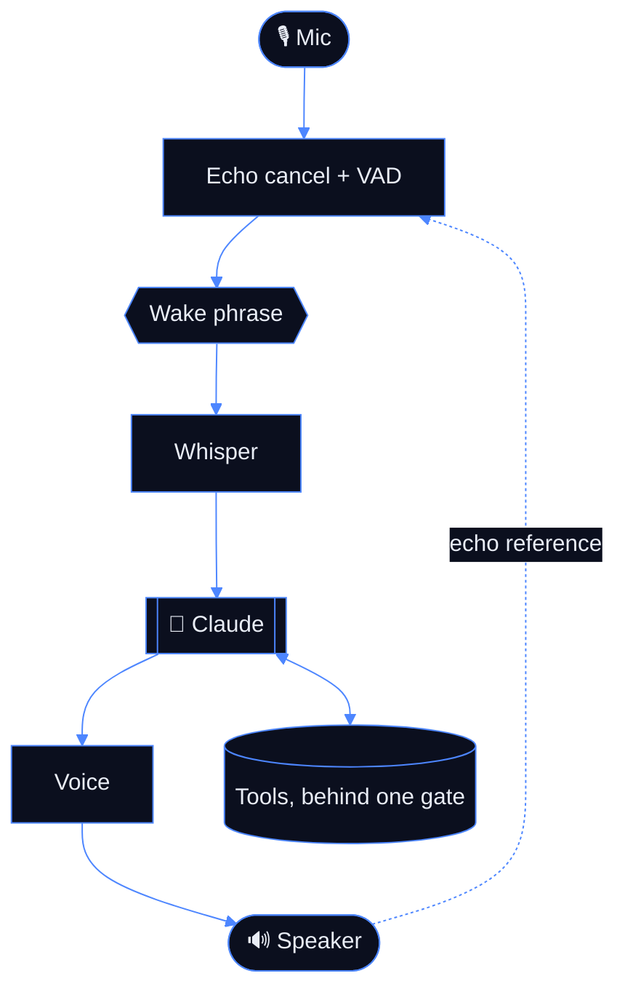

</details>

<details>
<summary><b>🎛️ The voice state machine</b></summary>

<br>

The state lives in one place. The island, the tray and the main window only listen to it.

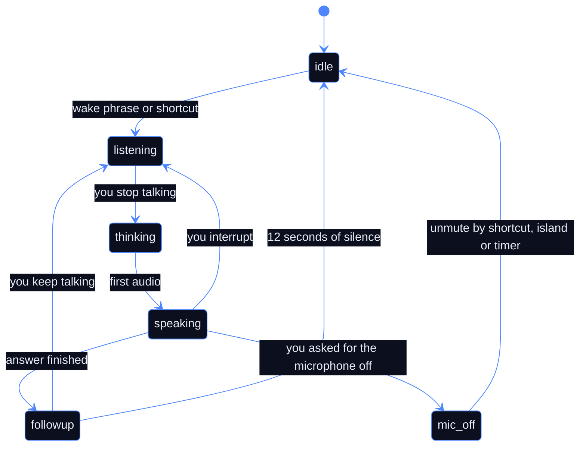

The same thing as a table, for small screens:

| State | Event | Next |
|:--|:--|:--|
| idle | wake phrase, shortcut or a click on the island | listening |
| listening | you stop talking | thinking |
| thinking | first audio | speaking |
| speaking | answer finished | follow-up |
| speaking | you interrupt | listening |
| follow-up | you keep talking | listening |
| follow-up | 12 seconds of silence | idle |
| speaking | you asked for the microphone off, and it has confirmed | mic off |
| mic off | shortcut, island or timer | idle |

Interrupting works by simply talking. The microphone runs through an echo canceller that takes the assistant's own playback as a reference, so on a speaker it can tell your voice from its own. When it is not sure, it lowers its volume and checks before it falls silent.

</details>

<details>
<summary><b>⏱️ The latency budget, and where we miss it</b></summary>

<br>

| Stage | Budget |
|:--|:--|
| Wake phrase ends → listening | ≤ 300 ms |
| End of speech detected | 500 to 700 ms of silence |
| Speech to text, 5 s of speech | ≤ 400 ms |
| Brain, first sentence | ≤ 1000 ms |
| Voice, first audio | ≤ 250 ms locally |
| **Last voiced frame → first audio (p50)** | **≤ 1.8 s without tools, ≤ 3.5 s with tools** |

Measured on 16 November 2026 on an RTX 4080 SUPER:

| Voice engine | First audio |
|:--|:--|
| Supertonic 3 · graphics card, the default | ≈ 0.09 to 0.15 s |
| EMA Lightning · graphics card | ≈ 0.03 s |
| Piper · processor | ≈ 0.06 to 0.11 s |
| ElevenLabs · cloud | ≈ 0.18 s on a warm connection |

And the part we do not hide: with Claude Code as the talking brain, a turn without tools measured about 1.9 to 2.3 seconds. That misses our own 1.8 second budget. Short exact jobs (the time, the date, "mute") are answered in code in about a second. The rest of the gap is the first token from the cloud, and it is still open.

</details>

<details>
<summary><b>🧠 Three brains, one gate</b></summary>

<br>

- **🗣️ The talking brain.** Spoken and written conversation. On my own desk today this is the Claude Code CLI installed on the machine: a personal, developer setup. It runs as a persistent warm process, the assistant's tools are handed to it through an in-app MCP server, and Claude Code's own tools are switched off. The commercial version will follow Anthropic's terms for third-party products, and that is what the next path is for.
- **☁️ Anthropic API, by role.** Four roles: `voice`, `deep`, `memory`, `vision`. Streaming, with a hand-written tool loop, on an API key that is stored encrypted on the machine. Deep work (research, looking at the screen, writing new skills) goes here or to Claude Code.
- **💻 A local model, the fallback.** When there is no key, no credit, no network, or Private mode is on. A small model on the same machine. It sees only a core subset of the tools, and it tells you it has taken over at most once a day.

Every tool call from every brain passes through the same gate: emergency stop, module permission, Private mode, authority level, approval card.

In Private mode no request leaves for any cloud model. If there is no local model either, there is no answer, and the assistant says why. One known gap, written down as such: if you pick a cloud voice, the sentence to be spoken still goes to that voice provider. The default voice is local.

OpenAI-compatible providers plug into the same roles, so the assistant is not welded to one vendor.

</details>

<details>
<summary><b>💾 Memory that knows where it came from</b></summary>

<br>

Four layers, from raw to durable:

`transcript` → `episodes` → `facts` → `commitments`

- Every record carries a **source** (spoken, typed, ambient, imported), a time and a confidence.
- Search is SQLite FTS5 plus recency plus importance.
- A contradicting fact marks the old one as superseded. It does not silently overwrite it.
- Something the model inferred can never override something you said yourself.
- Anything that looks like a secret (a password, a card, an ID number) is not written to the profile.
- You can open a page called "How do you know me", read every entry with its source, correct it or delete it.

</details>

<details>
<summary><b>🔕 The Attention Manager</b></summary>

<br>

Modules never draw a notification. They state an intent, and one place decides the channel.

| What you are doing | What the assistant does |
|:--|:--|
| 🎮&nbsp;Full-screen game or presentation | No visuals. Only an urgent item gets a short sound |
| 🎥&nbsp;In a meeting | No sound. A silent toast in the corner |
| 🌙&nbsp;Quiet hours | Everything waits, then arrives as one morning summary |
| 💻&nbsp;Normal work | By priority: island and voice, a toast, or just the Today board |

No surface steals focus, swallows a click or covers a game.

</details>

<details>
<summary><b>🛠️ It builds itself, with permission</b></summary>

<br>

Two layers, and the assistant decides which one a request needs.

**Layer 1 · Workshop.** The assistant writes a plugin: a tool, a board card, a page, a scheduled job, a voice command. Pages run in a sandbox with no network. You are shown what will be added and which permissions it asks for. By default nothing is installed without your approval, and the app does not restart.

**Layer 2 · Core.** For anything a plugin cannot reach, it changes its own source code with Claude Code. Only in developer mode, and only in a separate git worktree, never in the working copy.

`queued` → `planning` → `implementing` → `verifying` ⇄ `fixing` → `packaging` → `ready` → `installing` → `restarting` → `installed`

The plan is written in plain language before a file is touched. If a plugin would have been enough, it says so and stops. Installing a core change, and rolling one back, each take two separate explicit approvals at every authority level.

</details>

<details>
<summary><b>🧩 A module is a folder</b></summary>

<br>

A new ability is a folder with a contract. The core does not change.

```ts
// How much is asked depends on
// the risk and on the authority
// level the user has set.
export type Risk =
  | 'read'
  | 'write'
  | 'danger';

export interface ToolDef<I = unknown> {
  // "reminder_create"
  name: string;
  // written for the model:
  // when to use it
  description: string;
  input: z.ZodType<I>;
  risk: Risk;
  run(
    input: I,
    ctx: ToolContext,
  ): Promise<ToolResult>;
}
```

Modules do not import each other. They publish and listen on a typed bus. For computer use, a tool whose permission is switched off is not even registered, so the model can neither see it nor call it.

</details>

<details>
<summary><b>📜 The eight rules of the house</b></summary>

<br>

1. **Few, but working.** A feature is not "there" until it has been tried in real conditions.
2. **Small core, everything a module.**
3. **Voice first.** You should never have to open the app.
4. **Respect the screen.** Nothing steals focus or swallows a click.
5. **Managed from one place.** Models, voices, prompts and keys are settings, not code.
6. **An honest assistant.** It does not say "done" about something it did not do.
7. **One design system.**
8. **Code in English, interface from a dictionary.** Turkish first, then English.

</details>

<br>

<a name="ch3"></a>

<picture>
  <source media="(prefers-color-scheme: dark)" srcset="assets/chapter-03-dark.svg">
  <source media="(prefers-color-scheme: light)" srcset="assets/chapter-03-light.svg">
  
</picture>

## 🥽 Chapter 3 · Beyond the screen

The assistant should not end at the edge of a monitor. These experiments take it off the desk. In v3 the device bridge is a built-in module that can be switched off. In the v2 source edition the headset and the watch ship as optional plugins, kept outside the core on purpose.

<picture>
  <source media="(prefers-color-scheme: dark)" srcset="assets/beyond-dark.svg">
  <source media="(prefers-color-scheme: light)" srcset="assets/beyond-light.svg">
  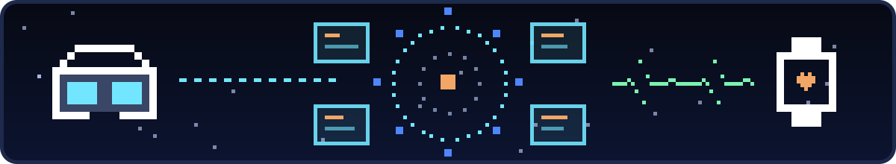
</picture>

<table>
<tr><td width="64" align="center"></td><td><b>A holographic HUD (JARVIS mode)</b><br>A holographic full-screen mode on the desktop: environment, calendar, system load, markets, links and the assistant's log on one heads-up display.</td></tr>
<tr><td width="64" align="center"></td><td><b>Meta Quest 3</b><br>The same HUD in mixed reality, built for hand tracking. From the headset you can switch tabs, change the palette, open an item or trigger the emergency stop.</td></tr>
<tr><td width="64" align="center"></td><td><b>Galaxy Watch</b><br>Heart rate, battery and wear state from the wrist, shown on a Watch page next to everything else.</td></tr>
<tr><td width="64" align="center"></td><td><b>A private bridge</b><br>Devices pair with a QR code and a six-digit PIN, then talk over an encrypted link (X25519, HKDF, AES-256-GCM) on the local network. Nothing passes through a server.</td></tr>
</table>

<details>
<summary><b>🔌 A plugin in v2, a module in v3</b></summary>

<br>

A headset bridge needs a network listener, pairing and native UI. The Workshop sandbox has none of those on purpose. So in the v2 source edition, device integrations ship as source overlays that an installer copies into the core tree and can remove again, file by file. There the core stays unaware of headsets: it publishes a snapshot and device events on its bus, and the Quest plugin is the only code that knows what a headset is.

In v3 the same bridge is a module that ships with the app and is on by default. The headset app is a Unity 6 project. The watch app is Kotlin for Wear OS.

</details>

<br>

<a name="ch4"></a>

<picture>
  <source media="(prefers-color-scheme: dark)" srcset="assets/chapter-04-dark.svg">
  <source media="(prefers-color-scheme: light)" srcset="assets/chapter-04-light.svg">
  
</picture>

## 🧠 Chapter 4 · FUBERNEURO

**AI that understands thought, with nothing in between.**

Today you type, tap and speak to tell a machine what you want. Each of those is a translation of a thought, and every translation loses something. FUBERNEURO is our research program on removing that translation: first for people who cannot speak or move, then for everyone else.

It is the AI for a neural interface designed to be implanted in the brain. **It is at an early stage.** Research and design are under way. There is no device, no clinical study and no result to report yet, and we say so on the site as well.


**The decoder is our part of the problem.** Recording the signal is half the job. The other half is AI that pulls intent, in real time, out of a noisy recording that changes a little every day.

<picture>
  <source media="(prefers-color-scheme: dark)" srcset="assets/neuro-dark.svg">
  <source media="(prefers-color-scheme: light)" srcset="assets/neuro-light.svg">
  
</picture>

<sub>Illustrative animation. Not real neural data.</sub>

The decoder we are designing works in four steps:

| Step | What happens |
|:--|:--|
| 📡&nbsp;**Record** | Each channel is recorded at tens of thousands of samples per second |
| ✂️&nbsp;**Extract** | The device extracts spike events instead of sending the raw signal |
| 🧮&nbsp;**Decode** | A model predicts intent from the pattern in real time |
| 🔁&nbsp;**Adapt** | The signal drifts from day to day, and the model quietly recalibrates |

It is designed so that the heavy lifting happens on the device and raw neural data never leaves it.

<details>
<summary><b>🗺️ Roadmap: four phases, each gated by evidence</b></summary>

<br>

| Phase | What it is |
|:--|:--|
| **0 · Research and design**<br>🟢 Under way | Literature review, comparing decoding methods on open neural datasets, system architecture, a safety and ethics framework |
| **1 · Decoder core**<br>⏭️ Next | Offline decoder models on open datasets: first cursor control and the intent to write, then speech |
| **2 · Bench prototype**<br>🗓️ Planned | Low-power recording electronics and wireless transfer on a lab bench. Nothing is implanted in a living being |
| **3 · Partnerships and approvals**<br>🎯 Goal | Studies with academic and clinical partners. No study in living beings without ethics committee and regulatory approval |

</details>

<details>
<summary><b>❓ The open questions we are working on</b></summary>

<br>

- **The same signal for years.** The brain reacts to anything implanted, and recordings can weaken over time. How much of that can electrode design reduce?
- **Learning from little data.** Can a decoder learn one person's intent in minutes, from a handful of examples?
- **Computing without heat.** Tissue may warm by only about 1 °C. How much AI fits on the device inside that budget?
- **A brain that keeps changing.** Recordings drift within a single day. Can the model follow without making the user recalibrate?

</details>

<details>
<summary><b>🤝 Principles first</b></summary>

<br>

- **Consent comes before everything.** No signal is read without its owner's explicit permission, and that permission can be withdrawn at any time.
- **Your mind is yours.** Neural data is never sold, never shared, never turned into advertising.
- **Security is the foundation**, not a feature added later.
- **Science speaks openly.** When we have a result, we will share it with the evidence. Until then, this is a research program.

The published results the program builds on belong to other research groups, and the site cites them as such.

</details>

→ [Read the program at fuber.ai/research](https://fuber.ai/research/) <sub>(the site still lists it as Fuber Research)</sub>

<br>

<a name="ch5"></a>

<picture>
  <source media="(prefers-color-scheme: dark)" srcset="assets/chapter-05-dark.svg">
  <source media="(prefers-color-scheme: light)" srcset="assets/chapter-05-light.svg">
  
</picture>

## 🧰 Chapter 5 · The shelf

Four products have a page of their own. ZILKO, Fuber AI and FuberWords can be used today, and BIDORA (Android) is available on request. Each one takes over a single job, end to end, and each one leaves the decision with you.

<picture>
  <source media="(prefers-color-scheme: dark)" srcset="assets/shelf-dark.svg">
  <source media="(prefers-color-scheme: light)" srcset="assets/shelf-light.svg">
  
</picture>

<table>
<tr>
<td align="center" width="50%" valign="top"><br><b>ZILKO</b><br>The AI receptionist for appointments and reservations<br><a href="https://zilko.co">zilko.co</a></td>
<td align="center" width="50%" valign="top"><br><b>BIDORA</b><br>Social media and advertising, run from one app<br><a href="https://bidora.fuber.ai">bidora.fuber.ai</a></td>
</tr>
<tr>
<td align="center" valign="top"><br><b>Fuber AI · mobile and web</b><br>Many AI models, one app<br><a href="https://chat.fuber.ai">chat.fuber.ai</a></td>
<td align="center" valign="top"><br><b>FuberWords</b><br>Words that come to you<br><a href="https://word.fuber.ai">word.fuber.ai</a></td>
</tr>
</table>

### 📞 ZILKO

**The AI receptionist for appointments and reservations.**

ZILKO answers the phone, and the Instagram, WhatsApp and Messenger messages, day and night. It finds the free slot in your calendar, tells the customer and writes the booking in itself.

<details>
<summary><b>What it does</b></summary>

<br>

- 📲 Runs on your existing number. There is no new line to buy.
- 🌍 Replies to messages in the customer's language. The site is in Turkish, English, German and French.
- 📝 Every call arrives with a summary, the recording and the contact details.
- 🙋 When the decision should be yours, it hands the conversation to you.

</details>


→ [zilko.co](https://zilko.co)

### 📣 BIDORA

**Social media and advertising, run from one app.**

BIDORA works out the monthly content plan, produces the image and the copy, and keeps the ad side in the same place. An agent that sees all of the data in the app runs it.

<details>
<summary><b>What it does</b></summary>

<br>

- 🗓️ Post, story, reel and triple post on one calendar.
- 🎨 An image studio bound to your brand colour and typeface.
- ✅ The agent lists every action as a one-line summary. Nothing runs until you approve, and it can propose at most sixty actions in one turn, because a list too long to read is not consent.
- ⏸️ Ads are created paused, and putting them live stays with you. In this version the ad records stay inside the app: nothing is sent to Meta yet.
- 📒 Every write lands in an audit log you can search.

</details>


→ [bidora.fuber.ai](https://bidora.fuber.ai)

### 💬 Fuber AI · mobile and web

**Many AI models, one app.**

The Fuber AI app brings several models into one conversation, and you choose which one answers. What you start on the phone continues in the browser.

<details>
<summary><b>What it does</b></summary>

<br>

- 🧠 Put the same question to more than one model.
- 📎 Upload a PDF, a spreadsheet or a document and ask about it.
- 🖼️ Generate an image, or have one explained.
- 🎙️ Voice mode: talk instead of typing.
- 📤 Turn an answer into a PDF, Word, Excel, CSV, text or Markdown file. That conversion does not call a model.
- 🔑 There is no AI key inside the app. The model list is read from the server, so what is open can change without a new release.

</details>


→ [chat.fuber.ai](https://chat.fuber.ai) &nbsp;·&nbsp; [App Store](https://apps.apple.com/app/id6795594373) &nbsp;·&nbsp; [Google Play](https://play.google.com/store/apps/details?id=ai.fuber.chat)

### 🔤 FuberWords

**Words that come to you. No need to open the app.**

FuberWords brings the 10,000 most frequent English words to your home screen, your desktop and your notifications as quick questions. You answer with one tap.

<details>
<summary><b>What it does</b></summary>

<br>

- 🪟 A widget, a desktop card or a notification. The question shows up where you already look.
- 🔁 Say Easy, Medium or Hard. The FSRS spaced-repetition algorithm decides when the word comes back.
- 🧾 A1 to C2, most frequent first, with Turkish meanings, pronunciation and example sentences.
- 🆓 Free. No ads. No sign-up.

</details>


→ [word.fuber.ai](https://word.fuber.ai)

<br>

<a name="ch6"></a>

<picture>
  <source media="(prefers-color-scheme: dark)" srcset="assets/chapter-06-dark.svg">
  <source media="(prefers-color-scheme: light)" srcset="assets/chapter-06-light.svg">
  
</picture>

## 🧪 Chapter 6 · The lab

Ideas, with their real status. If something here is only a plan, it says so.

<picture>
  <source media="(prefers-color-scheme: dark)" srcset="assets/labboard-dark.svg">
  <source media="(prefers-color-scheme: light)" srcset="assets/labboard-light.svg">
  
</picture>

The board reads left to right: planned, in progress, beta, built. The badges below use the same four colours.

**Built**

-  🧬 **It rewrites itself.** Layer 2 of the self-development engine: the assistant changing its own source code in a worktree. Developer mode only. *Not yet proven on a real run.*
-  🗣️ **Speech-to-speech engines.** The voice engine is a pluggable interface, and the cascade in Chapter 2 is the default. A speech-to-speech engine (OpenAI Realtime) is written for the same slot. *Not yet tried against the real API.*
-  🧑‍🤝‍🧑 **A synthetic customer panel.** We put ZILKO's offer and prices in front of a panel of a hundred synthetic businesses and read what came back. *Kept as a method.*

**Beta**

-  👂 **Ambient listening.** The assistant keeps notes on what is said around it. The raw transcript is processed only by the local model and never leaves the computer. To decide whether to speak up, it may show a short note (never the transcript) to the talking brain. Audio is not stored, and transcript lines are deleted within seven days. *Off by default, behind an explicit consent screen.*

**In progress**

-  🎨 **A new design language for Fuber AI v3.** Three independent directions were built side by side as working screens and scored through three lenses. The one that won is spatial: the interface is five layers, and where a thing sits says what it is. It takes structure, material and spring physics from Apple, a warm ground, a serif voice and a calm tone from Anthropic, and it is a copy of neither. *Chosen on 23 November, now going into the app.*

**Planned**

-  🧠 **FUBERNEURO decoder core.** Offline decoder models on open neural datasets. *The next phase.*
-  🍎 **Fuber AI on the Mac.** *On the roadmap.*
-  👓 **A phone client and lightweight AR glasses** for the new core, so the assistant follows you out of the room. The Quest 3 headset client is in Chapter 3. *On the roadmap, not built.*
-  🎙️ **KANTO.** A voice and voice-over studio.
-  📒 **DEFTA.** Bookkeeping and document tracking.

<br>

<a name="ch7"></a>

<picture>
  <source media="(prefers-color-scheme: dark)" srcset="assets/chapter-07-dark.svg">
  <source media="(prefers-color-scheme: light)" srcset="assets/chapter-07-light.svg">
  
</picture>

## 🏗️ Chapter 7 · How we build

### 🤝 With Claude

Most of what you have read so far was built in **Claude Code**. Not as autocomplete: as a team.

<picture>
  <source media="(prefers-color-scheme: dark)" srcset="assets/agents-dark.svg">
  <source media="(prefers-color-scheme: light)" srcset="assets/agents-light.svg">
  
</picture>

1. **A plan comes first**, and it is questioned until it holds. One document is the single source of truth. An agent that has to contradict it says so in its report. It does not drift quietly.
2. **Independent work runs in parallel.** Each agent gets its own git worktree and its own branch.
3. **One integrator merges.** Type check and tests run in a separate integration tree, and only then does anything reach `main`.
4. **The model fits the job.** Smaller Claude models take the simple tasks, larger ones take the heavy ones.
5. **A green test run is not accepted on its own.** Someone looks at the actual screenshots.

That is how Fuber AI v2 went from an empty repository on 16 November 2026 to its sixteenth demo version on 18 November. By 23 November the v3 branch, which carries that history forward, held 615 commits. Fuber AI v3 and this page are made the same way.

Claude is also inside the product. It does the talking, it does the deep work, and it is what the assistant uses to write its own plugins.

### 🧭 What we hold ourselves to

| Rule | In practice |
|:--|:--|
| 🙋&nbsp;**The agent asks first, by default** | It lists what it intends to do, and anything that sends, deletes, pays or runs a command waits for approval. Skipping that is a level only the user can grant, explicitly |
| 🔍&nbsp;**No claim without evidence** | No prices, customer names, user counts, percentages or awards on our pages. A screen filled with sample data says "sample data" |
| 🪞&nbsp;**An honest assistant** | It does not say "done" about something it did not do. When it falls back to a weaker model, it says so |
| 🔒&nbsp;**Private when it matters** | No AI key is embedded in our apps. Conversations are used for model training only with explicit consent, and saying no does not block the service |
| 🧹&nbsp;**Craft** | Motion that respects "reduce motion". Layouts that survive a larger text size. Small details done properly, and the gaps we know about written down |

### 📖 Open where it matters

Where openness earns trust, we publish the code.

- **[Fuber AI v1](https://github.com/fberkehan/fuber-ai-v1)** is open source under **Apache-2.0**. It is fully self-contained: there is no Fuber server, account system, telemetry, update feed or licence check in the code.
- **[Fuber AI v2](https://github.com/fberkehan/fuber-ai-v2)** is source-available under **FSL-1.1-ALv2**: read it, run it, learn from it; after two years each release becomes Apache-2.0. Quest 3 and Galaxy Watch bridges ship separately as "for JARVIS" plugins.
- **Licences are read before anything ships.** The WhatsApp module is left out of the v1 release because it depends on a GPL-licensed library. Larger voices and models are downloaded at run time instead of being redistributed, and each one keeps its own licence.

<p align="center">
  <a href="https://github.com/fberkehan/fuber-ai-v1"></a>
  <a href="https://github.com/fberkehan/fuber-ai-v2"></a>
</p>

<br>

<a name="ch8"></a>

<picture>
  <source media="(prefers-color-scheme: dark)" srcset="assets/chapter-08-dark.svg">
  <source media="(prefers-color-scheme: light)" srcset="assets/chapter-08-light.svg">
  
</picture>

## 🗓️ Chapter 8 · Timeline

Only milestones with a date in our own records. All of it is 2026.

<picture>
  <source media="(prefers-color-scheme: dark)" srcset="assets/timeline-dark.svg">
  <source media="(prefers-color-scheme: light)" srcset="assets/timeline-light.svg">
  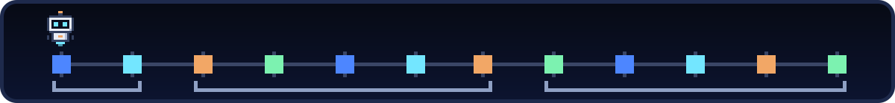
</picture>

| When | What happened |
|:--|:--|
| **24&nbsp;Sep** | 📣 BIDORA is written from scratch |
| **26&nbsp;Sep** | 🌐 fuber.ai relaunches in four languages with a new design language |
| **6&nbsp;Oct** | 📞 ZILKO moves to its own home, zilko.co |
| **14&nbsp;Oct** | 🌍 zilko.co goes live in Turkish, English, German and French |
| **18&nbsp;Oct** | 🔤 FuberWords joins the product shelf |
| **19&nbsp;Oct** | 🥚 Fuber AI for the desktop: the first build, and `0.5.0` by the end of the same day |
| **30&nbsp;Oct** | 📦 Fuber AI `0.12.0` |
| **13&nbsp;Nov** | 🖥️ The Fuber AI product page goes live in four languages |
| **16&nbsp;Nov** | 🐣 The rewrite starts. v2 `demo.1` is delivered the same day |
| **17&nbsp;Nov** | 🥽 Work starts on the Meta Quest 3 bridge |
| **18&nbsp;Nov** | 🛰️ v2 `demo.16`, the holographic HUD and the first headset build |
| **23&nbsp;Nov** | 🦅 Fuber AI `3.0.0-alpha.1`: one app. Source releases in preparation |

<br>

<a name="ch9"></a>

<picture>
  <source media="(prefers-color-scheme: dark)" srcset="assets/chapter-09-dark.svg">
  <source media="(prefers-color-scheme: light)" srcset="assets/chapter-09-light.svg">
  
</picture>

## 🧱 Chapter 9 · Stack

**🧠 AI**


**🖥️ Desktop**


**🥽 Devices**


**📱 Products and web**


<br>

<a name="epilogue"></a>

<picture>
  <source media="(prefers-color-scheme: dark)" srcset="assets/chapter-10-dark.svg">
  <source media="(prefers-color-scheme: light)" srcset="assets/chapter-10-light.svg">
  
</picture>

## ✉️ Epilogue

### 🔭 What is next

- 🦅 **Fuber AI v3** leaves alpha, and then comes the real test: six months on my own desk.
- 🧠 **FUBERNEURO** moves to Phase 1: offline decoder models on open neural datasets.
- 📦 **The v1 and v2 source** goes public, and the repositories get pinned on this profile.

### 🚪 The door

If you are a researcher, an engineer or a clinician, or you simply want to see how far a personal assistant can go: the door is at **[fuber.ai](https://fuber.ai)**. That is the one place to reach us.

And if the assistant ever writes to you on my behalf: unless I had handed it the keys for that job, it asked me first.

*Buraya kadar okuduysan: teşekkürler, hoş geldin.* 👋

<br>

<div align="center">

<picture>
  <source media="(prefers-color-scheme: dark)" srcset="assets/footer-dark.svg">
  <source media="(prefers-color-scheme: light)" srcset="assets/footer-light.svg">
  
</picture>

<picture>
  <source media="(prefers-color-scheme: dark)" srcset="assets/divider-dark.svg">
  <source media="(prefers-color-scheme: light)" srcset="assets/divider-light.svg">
  
</picture>

<sub><a href="https://fuber.ai">fuber.ai</a></sub>

</div>
